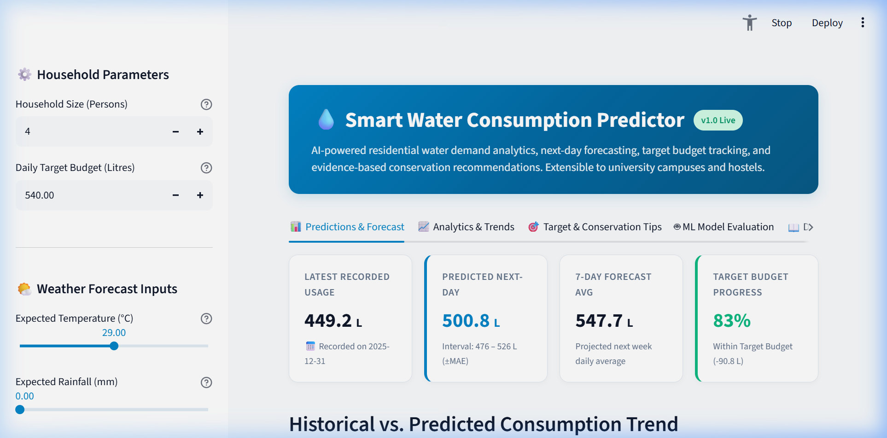
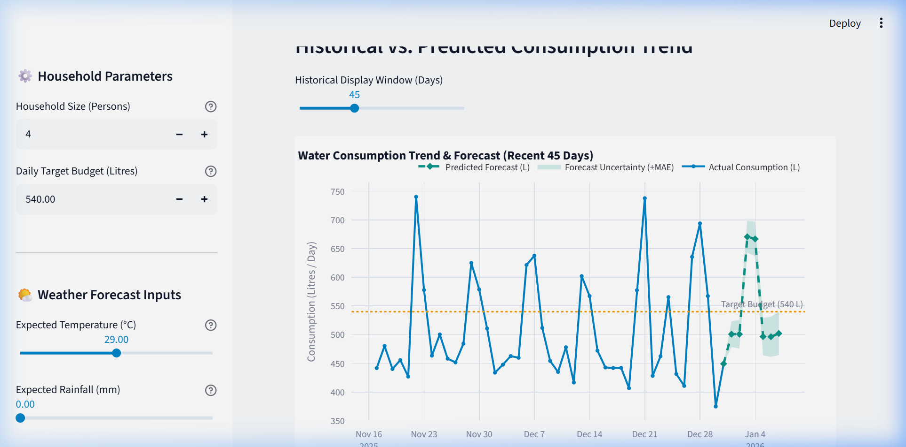
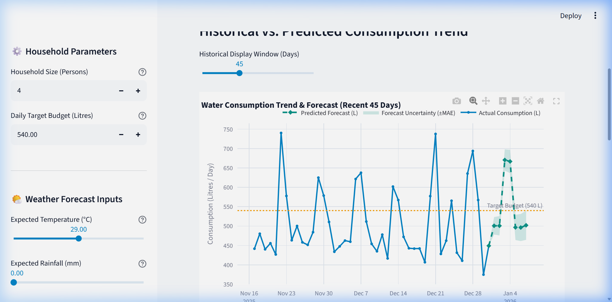
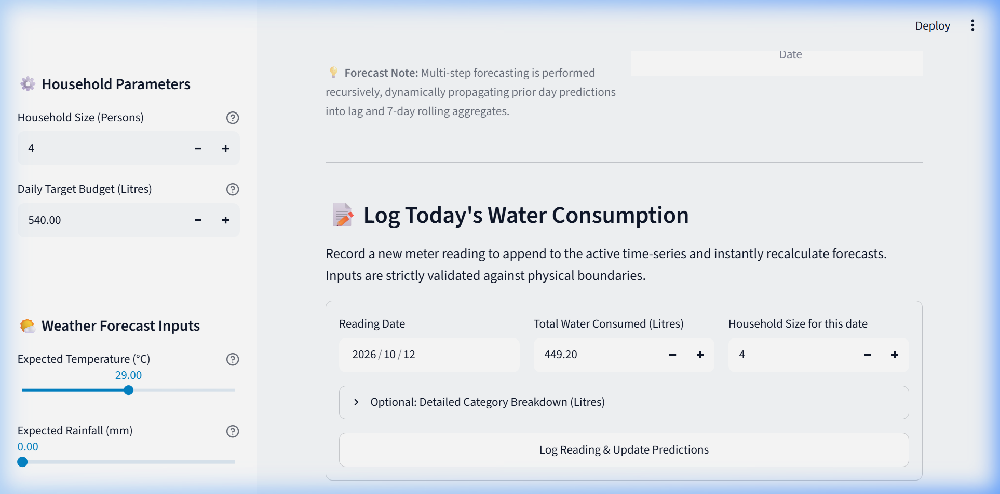

# 💧 Smart Water Consumption Predictor Using Machine Learning

[](https://www.python.org/)
[](https://streamlit.io/)
[](https://scikit-learn.org/)
[](https://plotly.com/)
[](tests/)
[](LICENSE)

An end-to-end, AI-powered predictive web application that models household water consumption patterns, generates next-day and 7-day multi-step recursive forecasts, tracks personal conservation target budgets, and delivers personalized water conservation recommendations. Designed as a rigorous 6-week AI/ML internship project with an extensible architecture for college campuses and hostels.

---

## 📸 Application Interface & Visual Walkthrough

| **Dashboard Overview & Next-Day Prediction** | **Historical Trend & 7-Day Forecast** |
|:---:|:---:|
|  |  |

| **Interactive Analytics & End-Use Breakdown** | **Target Progress & Conservation Engine** |
|:---:|:---:|
|  |  |

---

## 🌟 Core Features

- **Accurate Next-Day & 7-Day Forecasting:** Generates reliable daily predictions with empirical uncertainty bounds ($\pm\text{MAE}$) and captures weekly periodic demand surges.
- **Strict Leakage-Free Time-Series Modeling:** Employs shifted lag features ($y_{t-1}, y_{t-7}$) and shifted rolling statistics ($k=7, 14, 30$ days) to guarantee zero temporal data leakage.
- **Empirical Model Selection:** Evaluates baseline models against regularized linear and ensemble architectures on a chronological holdout test set (80/20 train/test split).
- **Interactive Water Budget Tracker:** Users configure daily thresholds (e.g., 540 Litres for a 4-person family based on BIS IS 1172 standards), displaying live gauge progress and 30-day cumulative savings.
- **Automated Anomaly & Leak Detection:** Identifies statistical anomalies ($Z \ge 2.5\sigma$) to flag potential pipe leaks, continuous toilet flapper drips, or tank overflows.
- **Personalized Conservation Engine:** Recommends quantified water-saving interventions (low-flow aerators, dual-flush conversions, full laundry cycles) with estimated litres saved per day and month.
- **Extensibility Blueprint:** Includes ready operational architectures for extending predictions to student hostels, academic blocks, and campus dining halls.

---

## 📊 Empirical Machine Learning Evaluation

All models were evaluated on an **out-of-sample chronological test set (last 20% of consecutive observations)** without shuffling to reflect genuine real-world production performance.

| Model | Model Family | Test MAE (L) | Test RMSE (L) | Test MAPE (%) | Test $R^2$ Score | Selection Verdict |
|:---|:---|:---:|:---:|:---:|:---:|:---:|
| **Ridge Linear Regression** | **Linear ML** | **43.16** | **56.67** | **8.39%** | **0.6239** | 🏆 **Champion Model** |
| **Random Forest Regressor** | Ensemble ML | 52.09 | 66.74 | 10.07% | 0.4782 | Strong Non-linear Candidate |
| **Gradient Boosting Regressor**| Ensemble ML | 60.97 | 80.36 | 11.94% | 0.2436 | Moderate Generalization |
| **Decision Tree Regressor** | Tree ML | 72.02 | 113.82 | 13.77% | -0.5175 | Overfit Training Data |
| **7-Day Moving Average** | Statistical Baseline | 77.02 | 94.82 | 14.77% | -0.0532 | Baseline (Smooths peaks) |
| **Naive Persistence (Lag 1)** | Rule Baseline | 83.61 | 113.86 | 16.04% | -0.5186 | Baseline (Fails on weekends) |

### 🔍 Key ML Insights
- **Baseline Outperformance:** Ridge Linear Regression achieved a **48.4% reduction in MAE** compared to the naive baseline (43.16 L vs 83.61 L).
- **Parsimony Over Complexity:** Regularized linear regression generalized superiorly to ensemble trees on this stationary daily series because cyclical components (sine/cosine transforms) and lag ratios behave linearly with low collinear variance.

---

## 📂 Project Structure

```
Smart Water Consumption Predictor/
├── .streamlit/
│   └── config.toml                  # Streamlit visual theme and server settings
├── data/
│   ├── generate_dataset.py          # Calibrated benchmark data generator (BIS 1172/WHO)
│   ├── processed/
│   │   └── water_consumption_daily.csv # 731 days of continuous daily consumption data
│   └── raw/
│       └── README.md                # Dataset research, standards, and transparency notice
├── models/
│   ├── trained_model.joblib         # Serialized champion model artifact
│   ├── eval_metrics.json            # Machine learning leaderboard metrics JSON
│   └── model_metadata.json          # Feature importances and evaluation metadata
├── src/
│   ├── __init__.py
│   ├── data_loader.py               # Data ingestion, cleaning, validation, and aggregations
│   ├── feature_engineering.py       # Strict leakage-free lag and rolling window transforms
│   ├── model.py                     # Chronological split, model training, and 7-day forecaster
│   ├── recommender.py               # Rule-based conservation tips and target budget calculator
│   ├── train.py                     # Pipeline runner for training and evaluating models
│   └── visualization.py             # Plotly interactive charting routines
├── tests/
│   ├── __init__.py
│   ├── test_app_smoke.py            # Streamlit app import and component smoke tests
│   ├── test_data_loader.py          # Data ingestion and input validation unit tests
│   ├── test_feature_engineering.py  # Leakage prevention and lag integrity tests
│   ├── test_model.py                # Model prediction, bounds, and forecast tests
│   └── test_recommender.py          # Budget tracking, leak alert, and recommender tests
├── app.py                           # Core interactive Streamlit dashboard
├── requirements.txt                 # Python package dependencies
├── .gitignore                       # Git exclusion rules
└── README.md                        # Project documentation
```

---

## 🚀 Getting Started (Run Locally)

### 1. Prerequisites
- Python 3.10 to 3.13 installed.
- Git installed.

### 2. Clone and Setup Environment
```bash
# Clone the repository
git clone https://github.com/<your-username>/smart-water-consumption-predictor.git
cd smart-water-consumption-predictor

# Create and activate virtual environment (optional but recommended)
python -m venv venv

# Windows:
venv\Scripts\activate
# Linux/macOS:
source venv/bin/activate

# Install required dependencies
pip install -r requirements.txt
```

### 3. Generate Demonstration Data & Train Model
```bash
# Generate the 731-day calibrated dataset (BIS IS 1172 standards)
python data/generate_dataset.py

# Train models, evaluate on chronological test set, and save artifacts
python src/train.py
```

### 4. Run the Pytest Test Suite
```bash
python -m pytest tests/ -v
```
*(All 20 unit tests should pass with 100% success rate.)*

### 5. Launch the Streamlit Web Application
```bash
streamlit run app.py
```
Open your browser at `http://localhost:8501`.

---

## 📜 Dataset Provenance & Honesty Notice

> **Transparency Disclosure:**  
> In compliance with strict academic and engineering ethics, the dataset utilized in this repository (`data/processed/water_consumption_daily.csv`) is a **calibrated synthetic demonstration dataset**. It has been parameterized directly from the **Bureau of Indian Standards (BIS IS 1172: 1993)** residential supply norm of **135–150 Litres per capita per day (LPCD)**, alongside WHO and AWWA end-use ratios. It should not be cited as physical telemetry from an active municipal smart meter.

---

## ⚖️ Scientific Disclaimer

Predictions and metrics provided by this system are statistical approximations based on historical data patterns, ambient weather forecasts, and calendar schedules. They are intended for demand planning and conservation coaching, not certified physical meter readings.

---
